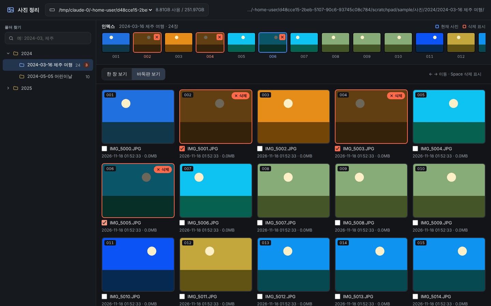

# 사진 정리

외장 하드디스크에 날짜별 폴더로 저장된 사진을 한 장씩 보면서 직접 골라 지우는 프로그램입니다.
중복 사진을 자동으로 찾아 주지는 않습니다. 사람이 보고 판단해서 삭제 표시를 하고, 마지막에 한 번에 삭제합니다.



## 화면 구성

| 위치 | 내용 |
|---|---|
| 좌측 | 폴더 탐색기. 드라이브 선택, 폴더 찾기, 폴더별 사진 수와 삭제 표시 수 |
| 우측 상단 | 인덱스. 폴더의 모든 사진을 번호와 함께 가로로 스크롤 |
| 중앙 | 메인 화면. **한 장 보기**(크게 보며 이전/다음)와 **바둑판 보기**(썸네일 + 체크박스) |
| 하단 | 삭제 표시한 사진 수와 용량, 모두 표시 / 표시 해제 / 삭제 |

삭제 표시한 사진은 주황 테두리, X 표시, 흐리게 처리로 구분됩니다.
삭제를 누르면 확인 창이 뜨고, 기본은 **휴지통으로 이동**입니다(휴지통에서 복원 가능). 체크하면 영구 삭제합니다.

### 단축키

| 키 | 동작 |
|---|---|
| ← / → | 이전 / 다음 사진 |
| Space 또는 Delete | 현재 사진 삭제 표시 / 해제 |
| Esc | 삭제 확인 창 닫기 |

## 설치와 실행

[Python 3.10 이상](https://www.python.org/downloads/)이 필요합니다(Windows 설치 시 "Add python.exe to PATH" 체크).

### Windows

`run.bat`을 더블클릭하면 됩니다. 처음 한 번은 필요한 패키지를 자동으로 설치합니다.
특정 폴더부터 열려면 명령 프롬프트에서:

```bat
run.bat --root "E:\사진"
```

### macOS / Linux

```bash
./run.sh --root "/Volumes/외장하드/사진"
```

실행하면 브라우저에 `http://127.0.0.1:8765` 화면이 열립니다. 종료는 실행 창에서 `Ctrl+C`.

### 옵션

| 옵션 | 설명 |
|---|---|
| `--root 경로` | 처음 열 사진 폴더 |
| `--port 번호` | 포트 변경 (기본 8765) |
| `--no-browser` | 브라우저를 자동으로 열지 않음 |

## 알아 둘 점

- **지원 형식**: JPG, PNG, GIF, BMP, WEBP, TIFF. RAW(CR2, NEF, ARW, DNG 등)는 목록에는 나오지만 미리보기는 없습니다.
  아이폰 HEIC 미리보기가 필요하면 `requirements.txt`에서 `pillow-heif` 줄의 주석을 풀고 다시 설치하세요.
- **썸네일 캐시**: 처음 여는 폴더는 썸네일을 만드느라 조금 느립니다. 만든 썸네일은 `사용자폴더/.photo-cleaner/cache`에 저장되어 다음부터 빠릅니다. 이 폴더는 언제 지워도 됩니다.
- **안전 장치**: 서버는 이 PC(127.0.0.1)에서만 접속됩니다. 삭제 요청은 실행할 때마다 새로 만드는 토큰이 있어야 처리되고, 사진 확장자가 아닌 파일은 지우지 않습니다.
- 외장 하드의 휴지통 동작은 OS에 따라 다릅니다. Windows는 드라이브마다 `$RECYCLE.BIN`에 보관합니다.

## 개발

```bash
pip install -r requirements.txt pytest
python -m pytest
```

구성: `app.py`(Flask 서버, 폴더/사진/썸네일/삭제 API), `static/`(화면: HTML, CSS, JS).
